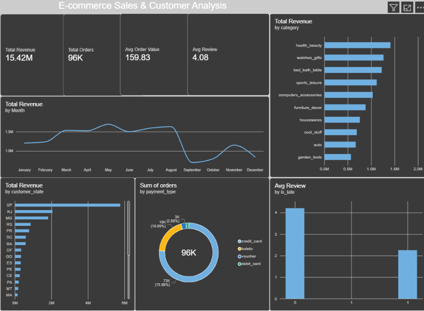

# E-commerce Sales & Customer Analysis

End-to-end analysis of 96K+ Brazilian e-commerce orders using Python, SQL and Power BI.

## Problem Statement
An online marketplace wants to know how its sales are trending, which products and regions drive revenue, who its loyal customers are, and whether late deliveries hurt customer satisfaction.

## Dataset
[Brazilian E-Commerce Public Dataset by Olist (Kaggle)](https://www.kaggle.com/datasets/olistbr/brazilian-ecommerce): about 100,000 orders from 2016 to 2018 across 9 CSV files.

## Tools Used
Python (pandas, matplotlib, seaborn), SQL (SQLite), Power BI, GitHub

## Business Questions
1. How do monthly revenue and order volume trend over time?
2. Which product categories and states drive the most revenue?
3. Who are the repeat customers vs one-time buyers?
4. Does late delivery reduce review scores?
5. Which payment methods are most popular?

## Approach
1. **Data cleaning:** kept delivered orders, removed duplicates, fixed dates, translated categories to English
2. **SQL analysis:** 8 queries using CTEs, window functions and RANK
3. **EDA:** charts for trends, categories, states, delivery time and payments
4. **RFM segmentation:** grouped customers into Champions, Loyal, Potential, At Risk and Lost
5. **Dashboard:** interactive Power BI dashboard with KPIs and slicers

## Dashboard

## Key Findings
- Revenue peaked in [month, year] at [value].
- The top 3 categories generate [X]% of total revenue.
- [X]% of customers bought only once.
- Late deliveries lowered the average review score from [X] to [Y].
- [State names] contribute [X]% of revenue.

## Recommendations
- Plan inventory and marketing ahead of peak months.
- Run loyalty offers and win-back campaigns to increase repeat purchases.
- Work with logistics partners to reduce late deliveries in the worst-affected states.

## How to Run
1. Download the dataset from Kaggle and put the CSV files in a folder named `data/raw`.
2. Install the libraries: `pip install pandas numpy matplotlib seaborn`
3. Run: `python ecommerce_analysis.py --data data/raw`
4. Results are saved in the `output` folder.

## Author
Gourav | [LinkedIn](https://linkedin.com/in/gourav-kangle-a7a51b313) | [GitHub](https://github.com/gouravkangle-max)
